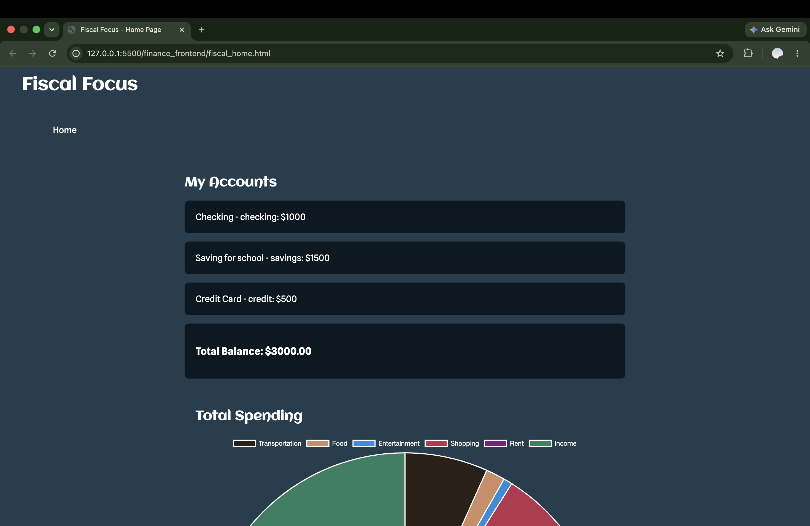
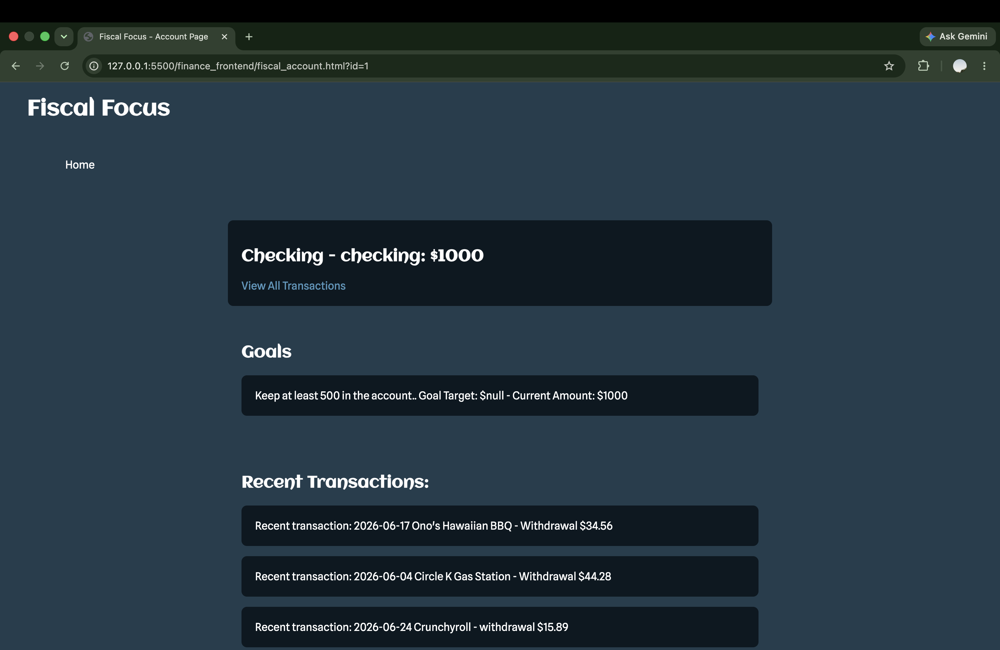
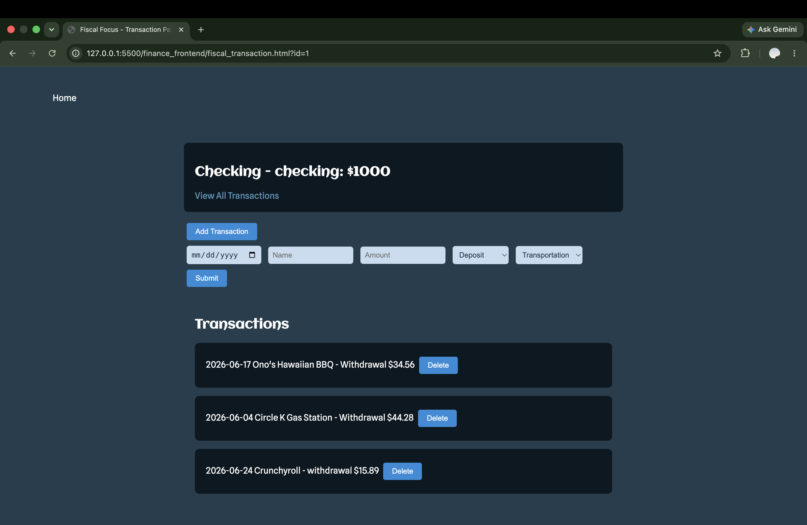

# Fiscal Focus

A full stack financial tracking web app that is built with Python, SQLite, and JavaScript. The user is able to track their finances by seeing what is being spent, goals for accounts, transactions in accounts, and even what is being spent in different categories.

## Stack
- Backend: Python, Flask
- Frontend: HTML (Jinja templates rendered by Flask), CSS, JavaScript (Chart.js)
- Database: SQLite

## Features
- Create multiple bank accounts to view and track the transactions within each account
- Add and delete transactions with automatic updates to the balance of the account.
- Show what is being spent in categories
- Add goals to each individual account
- Server-side error checking on the add-transaction form, with error messages shown on the page

## Future Improvements
- Automatic transaction categorization
- User authentication
- Edit existing transaction
- Track transactions, with flagging transactions if they are recurring.
- Add and delete accounts

## How to run locally
1. Clone the repository
2. Install dependencies:
    ```
    pip install flask flask-cors
    ```
3. Run the app:
    ```
    python3 finance_app.py
    ```
4. Navigate to `http://127.0.0.1:5000` in your browser. Flask builds and serves every page, so Live Server isn't needed.

## Screenshots




## Author
Built by Simon Taunima as a portfolio project